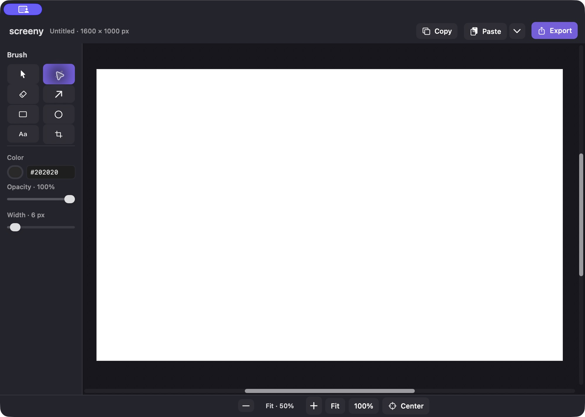

# screeny

A lightweight macOS app for drawing and annotating images.

[Download screeny](https://github.com/ni-ms/mac-screeny/releases/latest/download/screeny-macos-universal.zip) · macOS 14+ · Apple Silicon & Intel

- Draw with a brush, arrows, shapes, and inline text.
- Paste images, move items, erase, and crop.
- Zoom, pan, and export PNG or JPEG.

**Shortcuts:** ⌘V paste · ⌘C copy · ⌘Z undo · ⌘0 fit · ⌘S export

**First launch:** screeny is not notarized by Apple. If macOS blocks it, try opening it once, then go to **System Settings → Privacy & Security → Open Anyway** for screeny. [Apple’s instructions](https://support.apple.com/en-us/102445).

[Build and development instructions](DEVELOPMENT.md)
